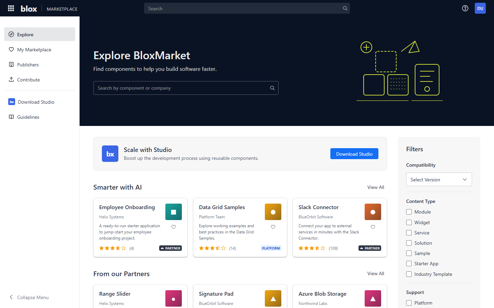
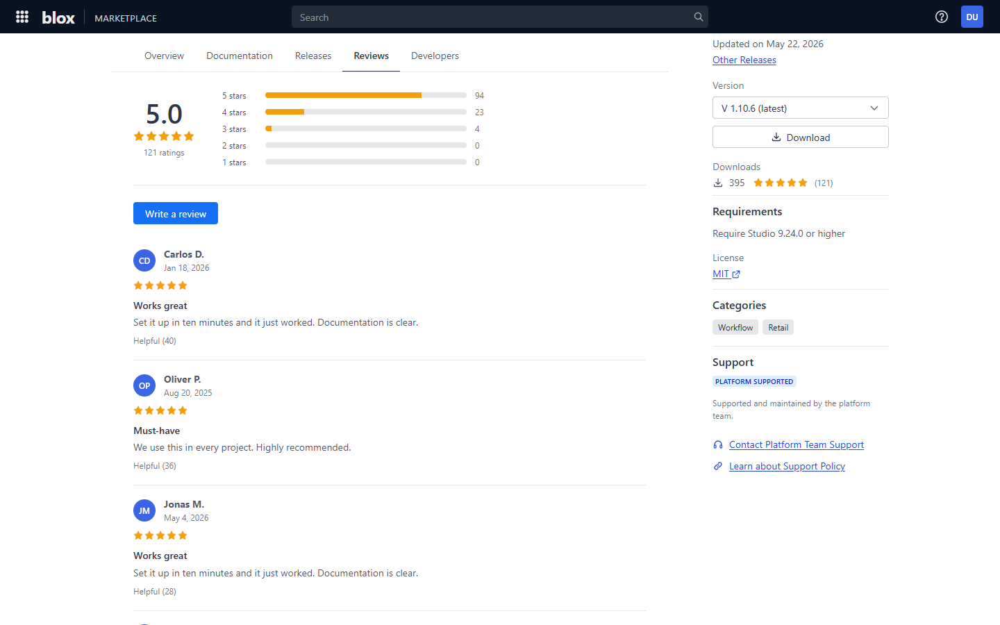
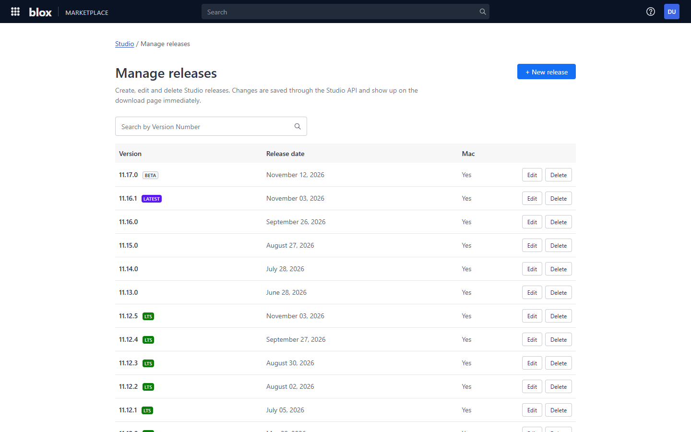
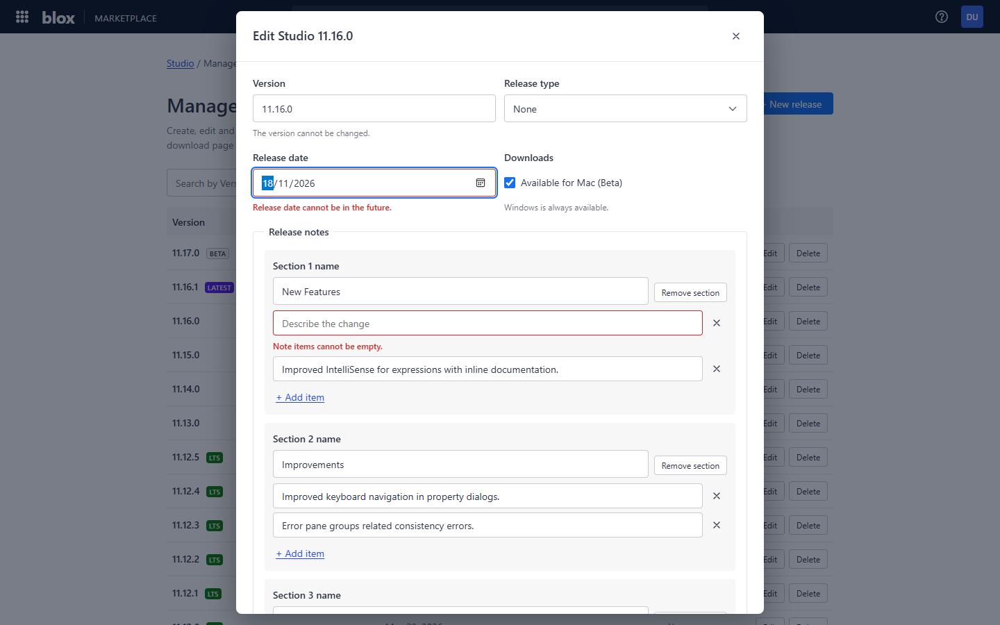
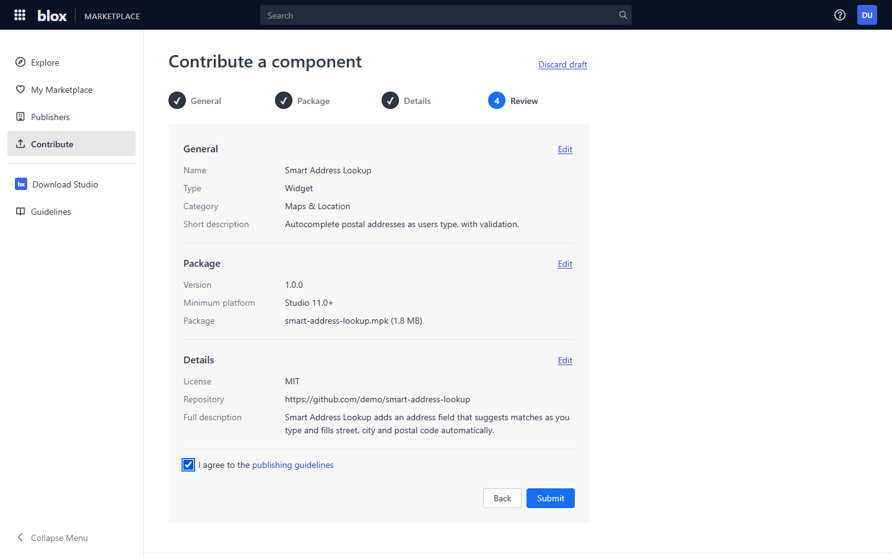
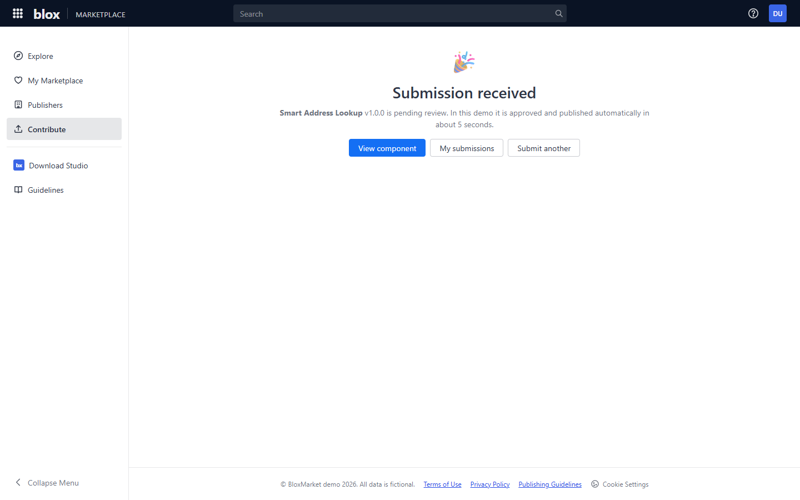
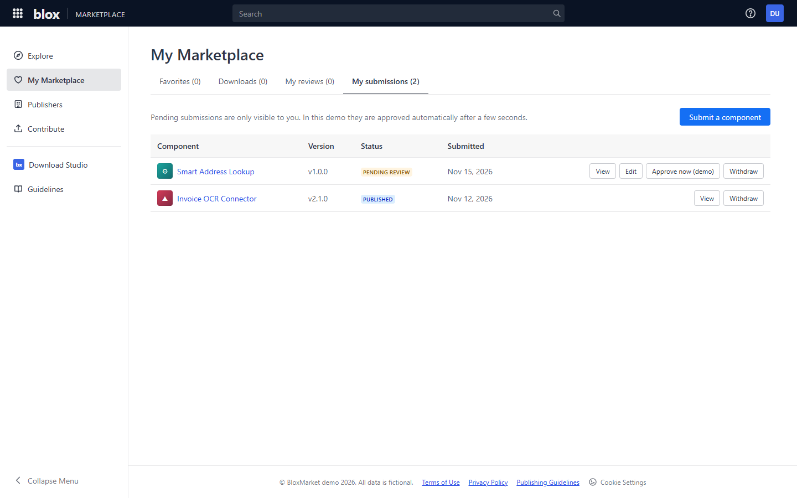
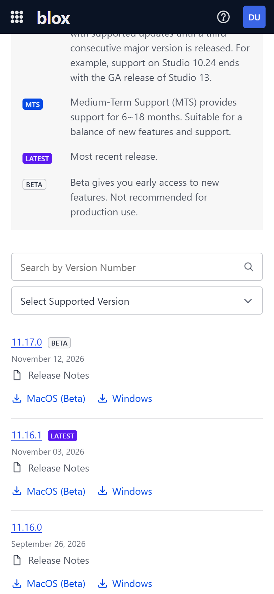

# BloxMarket – Component Marketplace

A demo component marketplace (modules, widgets, services, starter apps) built with React + Vite. The UI layout and colors are modeled on an enterprise low-code marketplace; all data is fictional and generated deterministically.



## Screenshots

### Filtered results

Selecting any filter (or searching) switches the explore page to a results view with removable filter chips, a result count, sorting and pagination.


### Component detail

Header with support badge, version requirement and actions; tabbed content; publisher, release, requirements, categories and support info in the side column.


### Reviews

Rating summary with distribution bars, a write-a-review form and helpful votes.



### Publishers


### Studio download page

Recommended LTS download with Windows / Mac buttons, latest-features panels, a release-type legend and a searchable, filterable, sortable release table with paging. Release notes open in a dialog.


### Manage releases

`/studio/manage` creates, edits and deletes releases through the Studio API, with a release-notes editor, inline validation (client-side and server `422` errors mapped onto fields) and delete confirmation.





### Contribute a component

A 4-step form with inline, accessible validation (name uniqueness, length limits with a live counter, semantic version, `.mpk`/`.zip` up to 50 MB, `https://` repository), draft autosave and a review step with per-section Edit links.






### My submissions

Track submissions from pending review to published. Pending submissions can be edited, approved instantly (demo) or withdrawn; published ones appear across the marketplace.



### Mobile

The sidebar collapses behind the menu button and filters open as a slide-in drawer. On the Studio page and in My submissions, table rows stack as cards.

<p>
  
  &nbsp;&nbsp;
  
  &nbsp;&nbsp;
  
</p>

## Features

- **Explore page** – hero search, curated sections (Smarter with AI, From our Partners, What's New, Most Downloaded)
- **Filtering** – compatibility, content type, support level, category, industry and rating; filters switch the page to a results view with removable chips, sorting and pagination (all state lives in the URL)
- **Component detail** – Overview, Documentation, Releases, Reviews and Developers tabs; version picker, download, favorite, share, write a review
- **My Marketplace** – favorites, download history, your reviews and **My submissions** (saved in `localStorage`)
- **Contribute** (`/submit`) – submit a component through a validated 4-step form with draft autosave; submissions go _pending → published_ (the demo reviewer approves after ~5 s, or instantly via "Approve now") and then appear in Explore, search, filters, sorting, "What's New" and on their own detail page. Pending submissions are visible only to you and can be edited (`/submit?edit=<id>`) or withdrawn
- **Studio download page** (`/studio`) – LTS / latest downloads, release types, release table with version search, supported-version filter, date sorting, paging and release-notes dialog; all data comes from the Studio API, with loading skeletons and error states with Retry
- **Studio Releases API** – a TypeScript REST API (Hono + Zod) with create, read, update and delete, file-backed persistence, and a **Manage releases** page (`/studio/manage`). See [Studio Releases API](#studio-releases-api)
- **Publishers** directory
- Responsive: collapsible sidebar, slide-in filter drawer on small screens

## Getting started

```bash
npm install
npm run dev       # web app (http://localhost:5173) + Studio API (http://127.0.0.1:5174), together
npm run dev:web   # web app only
npm run dev:api   # Studio API only (reloads on change)
npm run api:reset # reseed the API's data file
npm run build     # production build in dist/
npm run lint      # oxlint
npm run typecheck # tsc --noEmit (strict) — src, server, shared and API tests
npm run test:api  # API tests (node:test)
npm run test:e2e  # end-to-end browser tests
npm run deploy    # build and deploy to Cloudflare (see Deploying to Cloudflare)
npm run cf:dev    # run the Cloudflare Worker build locally
```

The project is migrating to TypeScript incrementally (`allowJs`): the data model, store, catalog, shared UI, the Studio API, and the Explore, Detail, Studio, Studio Manage, Submit and My Marketplace pages are `.ts`/`.tsx`; the remaining pages are still `.jsx`. Shared domain types live in `src/types.ts`.

## Studio Releases API

A small REST API for the releases shown on `/studio`, in `server/` (Hono, run by `tsx`). Request and response shapes are Zod schemas in `shared/studio.ts`, shared with the browser client in `src/api/studio.ts`, and every client response is validated against them.

- **Port:** `5174` (`PORT` to change). In development, Vite proxies `/api` to it (`API_URL` to change the target).
- **Data:** `server/data/releases.json` (gitignored; `DATA_DIR` to change). It is seeded from `src/data/studio.js` on first run; `npm run api:reset` reseeds it. Writes are serialized and atomic (temp file + rename). On Cloudflare, the same data lives in Workers KV instead (see [Deploying to Cloudflare](#deploying-to-cloudflare)).
- **CORS:** only the Vite origin (`http://localhost:5173`; `CORS_ORIGIN` takes a comma-separated list).
- **No authentication.** Anyone who can reach the API can create, change and delete releases. This is a demo; put real auth in front of it before exposing it anywhere.

### Endpoints (under `/api/studio`)

| Method | Path                 | Description                                                                                                                                                                                                                                                                                    | Success          |
| ------ | -------------------- | ---------------------------------------------------------------------------------------------------------------------------------------------------------------------------------------------------------------------------------------------------------------------------------------------- | ---------------- |
| GET    | `/releases`          | List. Query: `q` (version contains), `line` (e.g. `11.12`), `type` (`LTS`, `MTS`, `LATEST`, `BETA`, `none`), `sort` (`version` (default, newest first), `date-asc`, `date-desc`), `page` (≥ 1), `pageSize` (1–100, default 10). Returns `{ items, total, page, pageSize }`; items omit `notes` | 200              |
| GET    | `/releases/:version` | One release, including `notes`                                                                                                                                                                                                                                                                 | 200              |
| POST   | `/releases`          | Create. Body: `version`, `date`, optional `type`, `mac`, `notes`                                                                                                                                                                                                                               | 201 + `Location` |
| PUT    | `/releases/:version` | Full update. Body: `type`, `date`, `notes`, optional `mac`; `version` may be sent but can't change                                                                                                                                                                                             | 200              |
| PATCH  | `/releases/:version` | Partial update of any of `type`, `date`, `mac`, `notes`                                                                                                                                                                                                                                        | 200              |
| DELETE | `/releases/:version` | Delete                                                                                                                                                                                                                                                                                         | 204              |
| GET    | `/summary`           | `{ latest, recommendedLts, supportedLines, types }` for the page hero                                                                                                                                                                                                                          | 200              |
| GET    | `/health`            | `{ ok: true }`                                                                                                                                                                                                                                                                                 | 200              |

A release looks like `{ version, major, minor, patch, line, type, date, mac, notes }`. `major`, `minor`, `patch` and `line` are always derived from `version`; sending them is rejected.

### Rules

- `version` is `x.y.z` and unique (duplicate → `409`).
- `date` is a real `YYYY-MM-DD` date, not in the future.
- `notes`: at most 5 sections, each with 1–20 non-empty items of at most 300 characters.
- There is always exactly one `LATEST`:
  - setting a release to `LATEST` demotes the previous one in the same write (back to its line's `LTS`/`MTS` type, or none);
  - the current `LATEST` can't be changed to another type, or deleted, until another release is promoted (`409`);
  - a `BETA` release can't become `LATEST` (`422`).
- `mac` defaults to `true` for Studio 10 and later, and must be `false` below 10.

### Errors

Every error uses one shape:

```json
{
  "error": {
    "code": "validation_failed",
    "message": "The request body is invalid.",
    "details": [{ "field": "notes.Fixes.1", "message": "Note items cannot be empty." }]
  }
}
```

| Status | Codes                                                                          |
| ------ | ------------------------------------------------------------------------------ |
| 400    | `bad_json` (malformed body), `bad_query` (invalid or unknown query parameters) |
| 404    | `not_found` (unknown release or route)                                         |
| 409    | `conflict` (duplicate version), `latest_required`, `latest_protected`          |
| 422    | `validation_failed`; `details` lists each field (dotted path) and its message  |
| 500    | `internal`; no stack traces are returned                                       |

### Examples

```bash
API=http://127.0.0.1:5174/api/studio

curl "$API/releases?line=11.12&sort=date-desc&pageSize=5"
curl "$API/releases/11.16.1"
curl -X POST "$API/releases" -H "Content-Type: application/json" \
  -d '{"version":"11.17.1","date":"2026-11-14","type":"LATEST","notes":{"Fixes":["Fixed a crash on startup."]}}'
curl -X PATCH "$API/releases/11.17.1" -H "Content-Type: application/json" -d '{"notes":{"Fixes":["Fixed two crashes on startup."]}}'
curl -X PATCH "$API/releases/11.16.1" -H "Content-Type: application/json" -d '{"type":"LATEST"}'   # hand LATEST back
curl -X DELETE "$API/releases/11.17.1"
```

## MCP server (Claude Desktop)

`mcp/` is a [Model Context Protocol](https://modelcontextprotocol.io) server. With it, Claude Desktop can answer questions about marketplace components ("find top-rated AI connectors for 11.0", "compare X and Y") from the real catalog and the Studio Releases API. It runs locally over stdio, and Claude Desktop starts it automatically when it launches.

| Tool                     | What it returns                                                                                                                      |
| ------------------------ | ------------------------------------------------------------------------------------------------------------------------------------ |
| `search_components`      | Free-text search plus type, category, industry, support, publisher, license, rating, platform version and featured filters; sortable |
| `get_component`          | Full details for a slug, id or name, with close-match suggestions when it isn't found                                                |
| `get_component_reviews`  | Reviews (most helpful first), average rating and star breakdown                                                                      |
| `get_component_releases` | A component's release history and notes                                                                                              |
| `list_publishers`        | Publishers, optionally filtered by verified status or country, with component counts                                                 |
| `list_taxonomy`          | Valid types, categories, industries, support levels, licenses and platform versions                                                  |
| `compare_components`     | 2–4 components side by side                                                                                                          |
| `get_studio_summary`     | Latest Studio release, recommended LTS and supported lines (from the Studio API)                                                     |
| `get_studio_releases`    | Studio releases (filter, sort, paginate), or one version with its notes                                                              |

Resources: `marketplace://taxonomy` and `marketplace://component/{slug}`.

The catalog is imported straight from `src/data/components.ts`, and search reuses the Explore filter logic, so the answers match what the site shows. **User submissions are out of scope**: they live in each browser's `localStorage`, so the server can't see them.

### Setup

1. `npm install`
2. Try it with the MCP Inspector: `npm run mcp:inspect`, then open the URL it prints and call a tool.
3. Add the server to Claude Desktop's config. Open **Settings → Developer → Edit Config**. The file is `%APPDATA%\Claude\claude_desktop_config.json` for the regular installer, or `%LOCALAPPDATA%\Packages\Claude_<id>\LocalCache\Roaming\Claude\claude_desktop_config.json` for the Microsoft Store build. Merge this into `mcpServers`, with your own repo path:

   ```json
   {
     "mcpServers": {
       "component-marketplace": {
         "command": "node",
         "args": [
           "--import",
           "file:///C:/path/to/component-marketplace/node_modules/tsx/dist/loader.mjs",
           "C:\\path\\to\\component-marketplace\\mcp\\server.ts"
         ],
         "env": {
           "STUDIO_API_URL": "https://component-marketplace.component-marketplace.workers.dev/api/studio"
         }
       }
     }
   }
   ```

   This calls `node` with tsx's loader by absolute path rather than through `npx`, which avoids Windows PATH and `.cmd` shim problems. Point `STUDIO_API_URL` at `http://localhost:5174/api/studio` to use a local `npm run dev:api` instead of the deployed Worker. If you leave it out, the server uses the deployed Worker.

4. Fully restart Claude Desktop: quit it from the system tray, because closing the window isn't enough. The tools appear under the **+ → Connectors** menu in a chat.

Example questions: _"Find the top-rated Artificial Intelligence components compatible with platform 11.0"_, _"Tell me about the PDF Generator"_, _"Compare Excel Importer and Data Importer"_, _"Which verified publishers are in Germany?"_, _"What's the latest Studio release and what changed in it?"_

### Troubleshooting

- Logs: `%APPDATA%\Claude\logs\mcp-server-component-marketplace.log` (Store build: under the same `LocalCache\Roaming\Claude\logs` folder). On startup, the server logs `[mcp] component-marketplace server running on stdio` to stderr.
- `npm run mcp` starts the server by hand. It waits silently for MCP messages on stdin, which is expected.
- stdout carries the protocol, so code in `mcp/` must log only with `console.error`.
- Studio tools return an error that tells Claude the API is unreachable rather than failing, so the catalog tools keep working offline.

## Testing

`npm run test:mcp` covers the MCP tool handlers (search filters, sorting, limits, slug/id/name lookup, not-found suggestions, reviews, publishers, compare) and an in-memory client ↔ server round trip (tool list, calls, `isError`, resources).

`npm run test:api` starts the API on a random port with a temporary data directory and covers every endpoint, filter, sort and pagination edge, every rule and error code, LATEST demotion and delete protection, persistence across a restart, and concurrent writes (20 parallel creates, conflicting creates).

`npm run test:e2e` starts the Studio API (temporary data) and a Vite dev server, then drives a locally installed Edge or Chrome (headless, via `puppeteer-core`) through four suites:

- marketplace;
- Studio page (expected values are read from the API);
- the contribute flow (every validation rule, drafts, review/edit, double-submit protection, pending → published, edit, withdraw);
- managing releases (create, edit, delete, client and server validation, duplicate version, LATEST promotion on `/studio`, delete-LATEST refusal, API-down error states with Retry).

All suites also check mobile layouts. A run fails on any failed check or unexpected browser console error. Chrome logs every deliberate `409`/`422` response and every simulated network failure as a console error, so suites list those explicitly with `t.expectConsoleErrors(pattern, fn)`, scoped to that step.

The tests shorten or extend the demo auto-publish delay with `localStorage.setItem('mp.autoPublishMs', '<ms>')` (see `src/demoSettings.ts`) so timing is deterministic.

If the browser isn't found automatically, point it at one:

```bash
BROWSER_PATH="/path/to/chrome" npm run test:e2e
```

## Deploying to Cloudflare

The app runs on the Cloudflare Workers **free plan** as a single Worker:

- **Live URL:** https://component-marketplace.component-marketplace.workers.dev
- **Static app:** the Vite build in `dist/` is served as Workers static assets. Client-side routes such as `/studio` fall back to `index.html`.
- **Studio API:** `/api/*` runs `server/worker.ts`, which uses the same Hono app as local dev (`server/app.ts`).
- **Data:** release data is stored in the Workers KV namespace `component-marketplace-studio-kv` (binding `STUDIO_KV`, key `releases`), not in a file. It is seeded from `src/data/studio.js` on the first request.
- **Config:** everything is in `wrangler.jsonc`, including the account ID.

### Deploying a new change

1. Make your change and check it locally:

   ```bash
   npm run dev     # try it at http://localhost:5173
   npm run check   # lint, format, typecheck, build, API and e2e tests
   ```

2. Deploy:

   ```bash
   npm run deploy  # = npm run build && wrangler deploy
   ```

   This rebuilds `dist/`, uploads the app and the Worker, and prints the live URL. The new version is live within a few seconds.

3. Open the live URL and check the change.

4. Commit and push as usual. Deploying does not depend on git; it uploads whatever is in your working folder.

Stored release data is **kept** across deploys. A deploy never resets KV.

### First time on a new machine

```bash
npm install
npx wrangler login   # opens the browser; sign in to the Cloudflare account and click Allow
npx wrangler whoami  # should show the account
```

The login is saved, so you only do this once per machine. If `npm run deploy` later says you are not authenticated, run `npx wrangler login` again.

### Useful commands

| Task                                         | Command                                                            |
| -------------------------------------------- | ------------------------------------------------------------------ |
| Run the production Worker locally (local KV) | `npm run cf:dev`, then open http://localhost:8787                  |
| Stream live logs and errors                  | `npx wrangler tail`                                                |
| List recent deployments                      | `npx wrangler deployments list`                                    |
| Roll back to the previous version            | `npx wrangler rollback` (or `npx wrangler rollback <version-id>`)  |
| Reset live release data to the seed          | `npx wrangler kv key delete releases --binding STUDIO_KV --remote` |
| Look at the live release data                | `npx wrangler kv key get releases --binding STUDIO_KV --remote`    |

`npm run cf:dev` needs the `workerd` runtime. If npm held back its install script, allow it once with `npm install-scripts approve workerd`, then run `npm install` again.

Rolling back changes only the code. It does not undo changes to the release data.

### Free plan limits and caveats

- **Workers:** 100,000 API requests per day. Static asset requests are free and don't count.
- **KV:** 100,000 reads and 1,000 writes per day. Each API request does one read; each create, edit or delete does one write.
- **Eventual consistency:** KV can take up to about 60 seconds to show an edit to visitors in other regions.
- **No authentication:** anyone with the URL can change releases (see [Studio Releases API](#studio-releases-api)). To restrict it, put the site behind Cloudflare Access (Zero Trust; free for up to 50 users).

You can see usage, logs and the KV data in the Cloudflare dashboard under **Workers & Pages → component-marketplace** and **Storage & Databases → KV**.

## Project structure

```
src/
  App.jsx              routes
  types.ts             shared domain types (Component, Release, Review, Submission, …)
  store.tsx            favorites / reviews / downloads / submissions (localStorage) + toasts
  catalog.ts           useCatalog(): dummy catalog + the user's submissions
  demoSettings.ts      demo-only knobs (auto-publish delay)
  data/components.ts   dummy component data generator and constants
  data/studio.js       Studio release generator (seed data for the API)
  api/studio.ts        typed Studio API client
  hooks/useApiQuery.ts fetch hook with abort, loading/error state and reload
  lib/studioFormat.ts  date formatting for the Studio pages
  components/          layout shell, cards and badges (ui.tsx), Studio modal/badges (studio-ui.tsx), icons
  pages/               Explore (Browse), Detail, Studio, StudioManage, MyMarketplace, Publishers, Submit, Misc
  index.css            design tokens and all styles
shared/studio.ts       Zod schemas, types and rules shared by the API and the client
server/                Studio Releases API (app.ts routes, store.ts rules, file-persistence.ts JSON file storage,
                       server.ts, index.ts CLI, worker.ts Cloudflare Worker entry with KV storage)
mcp/                   MCP server for Claude Desktop (server.ts wiring, tools.ts pure handlers, schemas.ts inputs,
                       studio.ts Studio API client, result.ts ok/fail result type)
wrangler.jsonc         Cloudflare Workers deployment config
tests/api/             API tests (node:test)
tests/mcp/             MCP server tests (node:test)
tests/e2e/             browser test runner and suites (marketplace, studio, submit, studio-manage)
```
