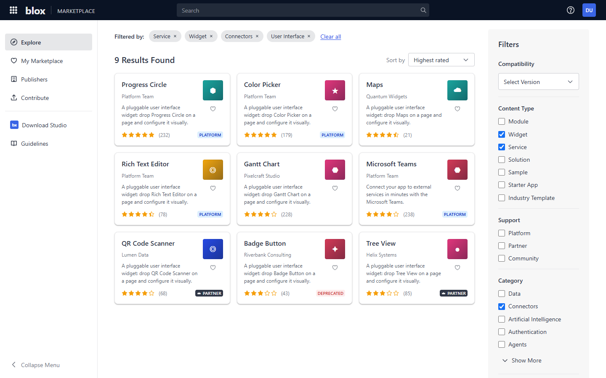
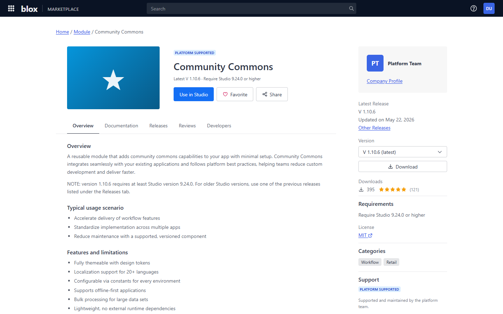
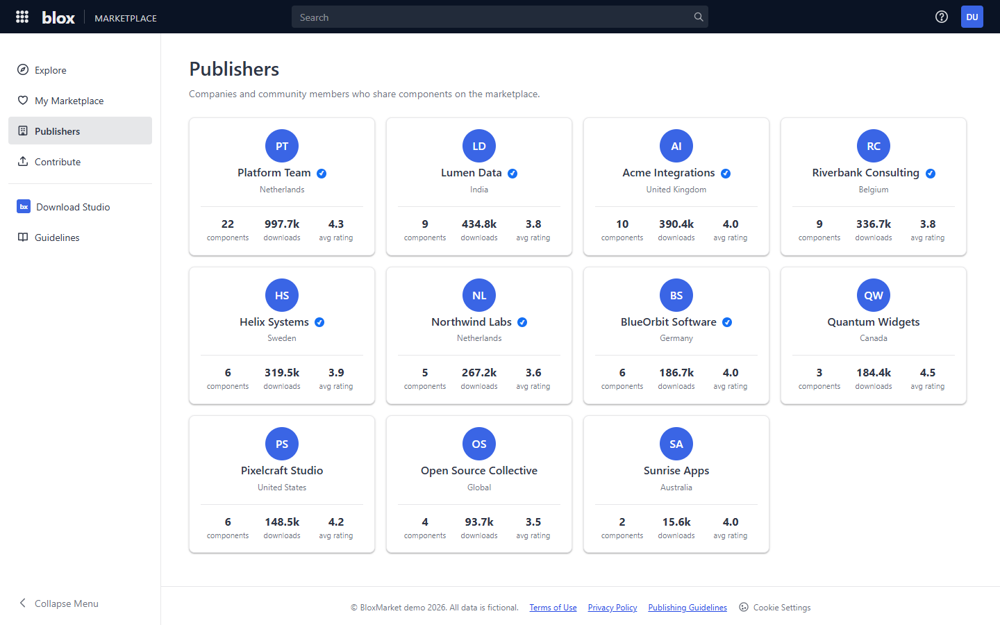
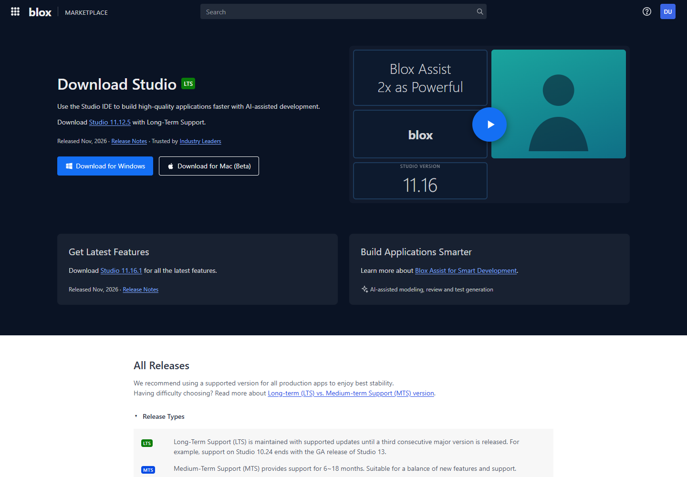
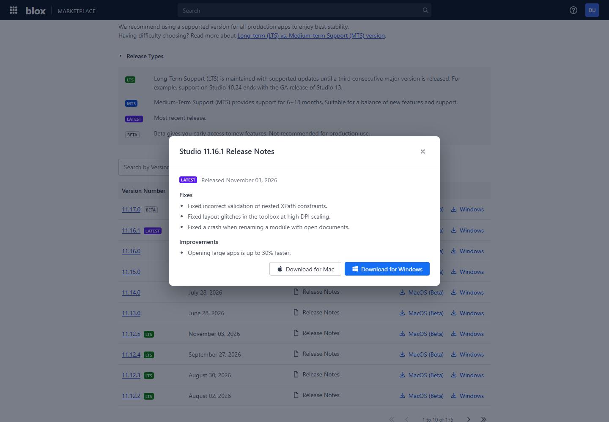

# BloxMarket – Component Marketplace

A demo component marketplace (modules, widgets, services, starter apps) built with React + Vite. The UI layout and colors are modeled on an enterprise low-code marketplace; all data is fictional and generated deterministically.


## Screenshots

### Filtered results
Selecting any filter (or searching) switches the explore page to a results view with removable filter chips, a result count, sorting and pagination.



### Component detail
Header with support badge, version requirement and actions; tabbed content; publisher, release, requirements, categories and support info in the side column.



### Reviews
Rating summary with distribution bars, a write-a-review form and helpful votes.


### Publishers



### Studio download page
Recommended LTS download with Windows / Mac buttons, latest-features panels, a release-type legend and a searchable, filterable, sortable release table with paging. Release notes open in a dialog.






### Mobile
The sidebar collapses behind the menu button and filters open as a slide-in drawer. On the Studio page, release rows stack as cards.

<p>
  
  &nbsp;&nbsp;
  
  &nbsp;&nbsp;
  
</p>

## Features

- **Explore page** – hero search, curated sections (Smarter with AI, From our Partners, What's New, Most Downloaded)
- **Filtering** – compatibility, content type, support level, category, industry and rating; filters switch the page to a results view with removable chips, sorting and pagination (all state lives in the URL)
- **Component detail** – Overview, Documentation, Releases, Reviews and Developers tabs; version picker, download, favorite, share, write a review
- **My Marketplace** – favorites, download history and your reviews (saved in `localStorage`)
- **Studio download page** (`/studio`) – LTS / latest downloads, release types, release table with version search, supported-version filter, date sorting, paging and release-notes dialog
- **Publishers** and a multi-step **Contribute** form
- Responsive: collapsible sidebar, slide-in filter drawer on small screens

## Getting started

```bash
npm install
npm run dev      # http://localhost:5173
npm run build    # production build in dist/
npm run lint     # oxlint
npm run test:e2e # end-to-end browser tests
```

## Testing

`npm run test:e2e` starts its own Vite dev server and drives a locally installed Edge or Chrome (headless, via `puppeteer-core`) through both the marketplace and the Studio page: navigation, filters, search, sorting, paging, dialogs, downloads, reviews, favorites and mobile layouts. It fails on any failed check or browser console error.

If the browser isn't found automatically, point it at one:

```bash
BROWSER_PATH="/path/to/chrome" npm run test:e2e
```

## Project structure

```
src/
  App.jsx              routes
  store.jsx            favorites / reviews / downloads (localStorage) + toasts
  data/components.js   dummy component data generator and constants
  data/studio.js       dummy Studio release history
  components/          layout shell, cards, icons
  pages/               Explore (Browse), Detail, Studio, MyMarketplace, Publishers, Submit, Misc
  index.css            design tokens and all styles
tests/e2e/             browser test runner and suites
```
