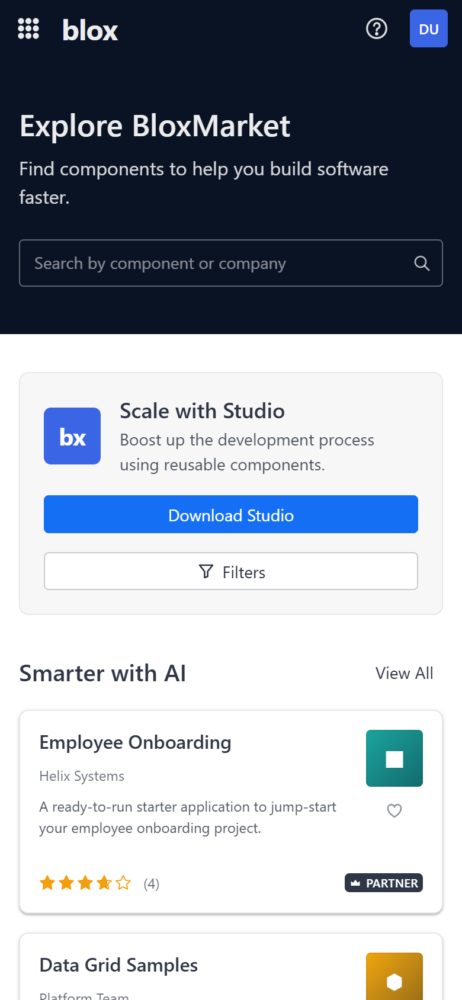

# BloxMarket – Component Marketplace

A demo component marketplace (modules, widgets, services, starter apps) built with React + Vite. The UI layout and colors are modeled on an enterprise low-code marketplace; all data is fictional and generated deterministically.


## Screenshots

### Filtered results
Selecting any filter (or searching) switches the explore page to a results view with removable filter chips, a result count, sorting and pagination.


### Component detail
Header with support badge, version requirement and actions; tabbed content; publisher, release, requirements, categories and support info in the side column.


### Reviews
Rating summary with distribution bars, a write-a-review form and helpful votes.


### Publishers


### Mobile
The sidebar collapses behind the menu button and filters open as a slide-in drawer.

<p>
  
  &nbsp;&nbsp;
  
</p>

## Features

- **Explore page** – hero search, curated sections (Smarter with AI, From our Partners, What's New, Most Downloaded)
- **Filtering** – compatibility, content type, support level, category, industry and rating; filters switch the page to a results view with removable chips, sorting and pagination (all state lives in the URL)
- **Component detail** – Overview, Documentation, Releases, Reviews and Developers tabs; version picker, download, favorite, share, write a review
- **My Marketplace** – favorites, download history and your reviews (saved in `localStorage`)
- **Publishers** and a multi-step **Contribute** form
- Responsive: collapsible sidebar, slide-in filter drawer on small screens

## Getting started

```bash
npm install
npm run dev      # http://localhost:5173
npm run build    # production build in dist/
npm run lint     # oxlint
```

## Project structure

```
src/
  App.jsx              routes
  store.jsx            favorites / reviews / downloads (localStorage) + toasts
  data/components.js   dummy data generator and constants
  components/          layout shell, cards, icons
  pages/               Explore (Browse), Detail, MyMarketplace, Publishers, Submit, Misc
  index.css            design tokens and all styles
```
