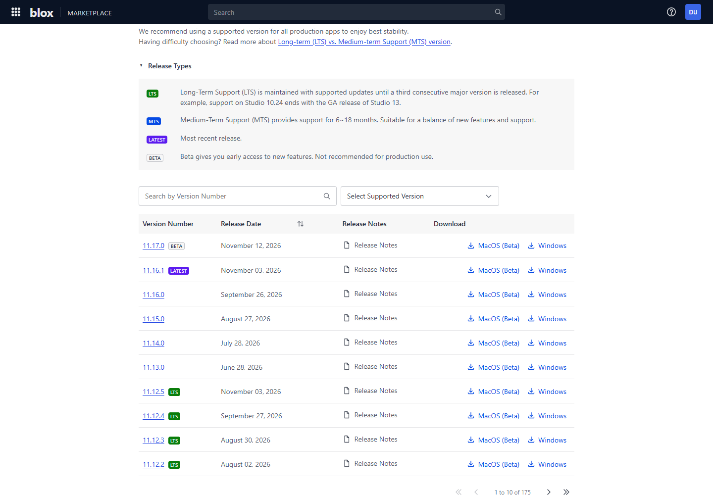
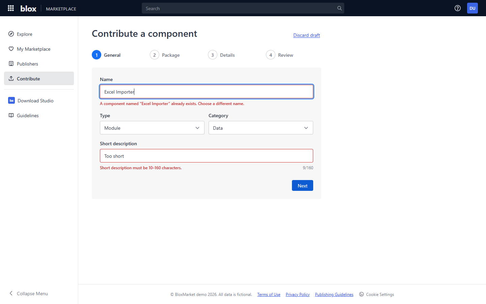
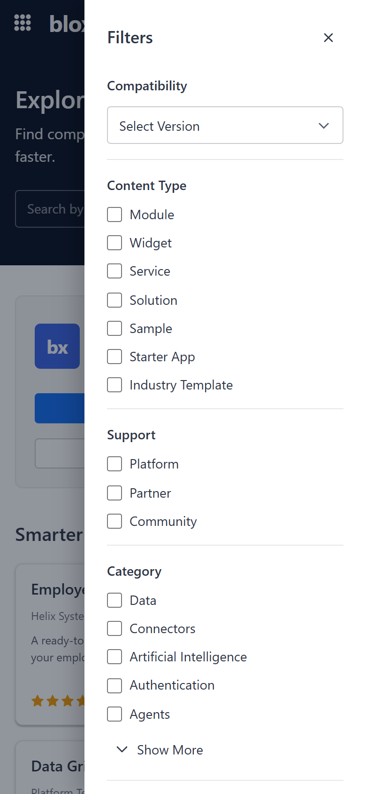

# BloxMarket – Component Marketplace

A demo component marketplace (modules, widgets, services, starter apps) built with React + Vite. The UI layout and colors are modeled on an enterprise low-code marketplace; all data is fictional and generated deterministically.


## Screenshots

### Filtered results
Selecting any filter (or searching) switches the explore page to a results view with removable filter chips, a result count, sorting and pagination.


### Component detail
Header with support badge, version requirement and actions; tabbed content; publisher, release, requirements, categories and support info in the side column.


### Reviews
Rating summary with distribution bars, a write-a-review form and helpful votes.


### Publishers


### Studio download page
Recommended LTS download with Windows / Mac buttons, latest-features panels, a release-type legend and a searchable, filterable, sortable release table with paging. Release notes open in a dialog.





### Contribute a component
A 4-step form with inline, accessible validation (name uniqueness, length limits with a live counter, semantic version, `.mpk`/`.zip` up to 50 MB, `https://` repository), draft autosave and a review step with per-section Edit links.




### My submissions
Track submissions from pending review to published. Pending submissions can be edited, approved instantly (demo) or withdrawn; published ones appear across the marketplace.


### Mobile
The sidebar collapses behind the menu button and filters open as a slide-in drawer. On the Studio page and in My submissions, table rows stack as cards.

<p>
  
  &nbsp;&nbsp;
  
  &nbsp;&nbsp;
  
</p>

## Features

- **Explore page** – hero search, curated sections (Smarter with AI, From our Partners, What's New, Most Downloaded)
- **Filtering** – compatibility, content type, support level, category, industry and rating; filters switch the page to a results view with removable chips, sorting and pagination (all state lives in the URL)
- **Component detail** – Overview, Documentation, Releases, Reviews and Developers tabs; version picker, download, favorite, share, write a review
- **My Marketplace** – favorites, download history, your reviews and **My submissions** (saved in `localStorage`)
- **Contribute** (`/submit`) – submit a component through a validated 4-step form with draft autosave; submissions go *pending → published* (the demo reviewer approves after ~5 s, or instantly via "Approve now") and then appear in Explore, search, filters, sorting, "What's New" and on their own detail page. Pending submissions are visible only to you and can be edited (`/submit?edit=<id>`) or withdrawn
- **Studio download page** (`/studio`) – LTS / latest downloads, release types, release table with version search, supported-version filter, date sorting, paging and release-notes dialog
- **Publishers** directory
- Responsive: collapsible sidebar, slide-in filter drawer on small screens

## Getting started

```bash
npm install
npm run dev      # http://localhost:5173
npm run build    # production build in dist/
npm run lint      # oxlint
npm run typecheck # tsc --noEmit (strict)
npm run test:e2e  # end-to-end browser tests
```

The project is migrating to TypeScript incrementally (`allowJs`): the data model, store, catalog, shared UI and the Explore, Detail, Submit and My Marketplace pages are `.ts`/`.tsx`; the remaining pages are still `.jsx`. Shared domain types live in `src/types.ts`.

## Testing

`npm run test:e2e` starts its own Vite dev server and drives a locally installed Edge or Chrome (headless, via `puppeteer-core`) through three suites — marketplace, Studio page, and the contribute flow (every validation rule, drafts, review/edit, double-submit protection, pending → published, edit, withdraw) — plus mobile layouts. It fails on any failed check or browser console error.

The tests shorten or extend the demo auto-publish delay with `localStorage.setItem('mp.autoPublishMs', '<ms>')` (see `src/demoSettings.ts`) so timing is deterministic.

If the browser isn't found automatically, point it at one:

```bash
BROWSER_PATH="/path/to/chrome" npm run test:e2e
```

## Project structure

```
src/
  App.jsx              routes
  types.ts             shared domain types (Component, Release, Review, Submission, …)
  store.tsx            favorites / reviews / downloads / submissions (localStorage) + toasts
  catalog.ts           useCatalog(): dummy catalog + the user's submissions
  demoSettings.ts      demo-only knobs (auto-publish delay)
  data/components.ts   dummy component data generator and constants
  data/studio.js       dummy Studio release history
  components/          layout shell, cards and badges (ui.tsx), icons
  pages/               Explore (Browse), Detail, Studio, MyMarketplace, Publishers, Submit, Misc
  index.css            design tokens and all styles
tests/e2e/             browser test runner and suites (marketplace, studio, submit)
```
